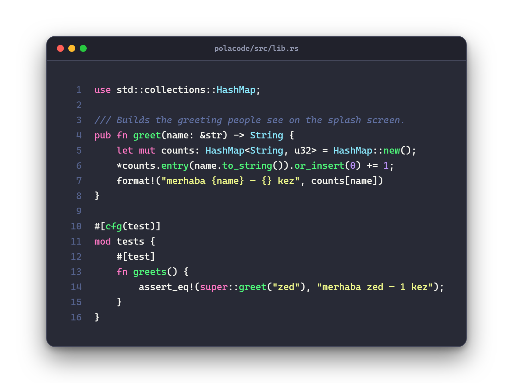
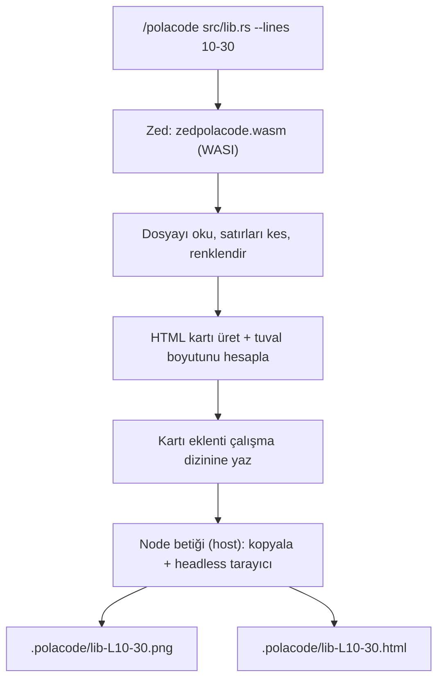

# Zed Polacode

[](https://github.com/talhayksk/zedpolacode/actions/workflows/ci.yml)
[](LICENSE)

VS Code'daki **Polacode** eklentisinin Zed sürümü. Kodu şık bir "kod kartına"
çevirir ve paylaşılabilir bir **PNG** (artı kaynak **HTML**) olarak projeye yazar.



```
/polacode src/main.rs --lines 120-160 --theme tokyo-night --bg gradient
```

---

## Kurulum

### Zed mağazasından

`zed: extensions` komut paletini aç → **Zed Polacode** ara → **Install**.
(Mağaza kaydı onaylandıktan sonra geçerli; aşağıdaki iki yol her zaman çalışır.)

### Geliştirici eklentisi olarak (hemen denenebilir)

```bash
git clone https://github.com/talhayksk/zedpolacode.git
```

Zed'de komut paleti → `zed: extensions` → **Install Dev Extension** → klonladığın
klasörü seç. Zed eklentiyi `wasm32-wasip1` için kendisi derler.

### Kaynaktan derleme

```bash
rustup target add wasm32-wasip1
cargo build --release --target wasm32-wasip1
# -> target/wasm32-wasip1/release/zedpolacode.wasm
```

### Gereksinimler

- Güncel Zed (extension API `0.7.0`).
- PNG üretimi için sistemde **Chrome, Edge, Chromium veya Brave** bulunmalı.
  Tarayıcı yoksa eklenti yine çalışır: HTML kart yazılır, PNG atlanır ve nedeni
  asistan çıktısında söylenir. Farklı bir tarayıcı için `ZEDPOLACODE_BROWSER`
  ortam değişkenine yolunu ver.

---

## Neden slash komutu?

Zed eklentileri iki şeyi yapamaz:

1. **Arayüz çizemez** — kendi panelini/pencereciğini açamaz.
2. **Kum havuzu dışına yazamaz** — WASI kum havuzu yalnızca eklentinin kendi
   çalışma dizinine yazmaya izin verir.

Bu yüzden özellik, Zed'in eklenti API'sinin izin verdiği tek etkileşim yüzeyini
kullanıyor: **`/polacode` slash komutu**. Kartın HTML'i Rust içinde üretiliyor;
dosyayı projeye yazma ve PNG'yi çekme işini host tarafında **Node** (Zed ile
birlikte gelir) ve **headless tarayıcı** yapıyor.

> Zed'in eklenti API'si editördeki *seçimi* eklentiye vermiyor. Bu yüzden satır
> aralığını `--lines` ile veriyorsun. (Editörde `Ctrl+G` / `Cmd+G` satır
> numaralarını gösterir.)

---

## Kullanım

Assistant panelini aç ve komutu yaz:

```text
/polacode src/store.rs --lines 40-70
/polacode src/App.tsx --theme nord --bg gradient
/polacode --file crates/core/src/lib.rs --lines 1-25 --title "core/lib.rs"
```

Kod bloğunu doğrudan da verebilirsin (proje açık olmasa bile çalışır):

```text
/polacode ```rust
let snapshot = capture(&buffer);
```
```

Çıktı `.polacode/` klasörüne yazılır:

```text
.polacode/store-L40-70.png
.polacode/store-L40-70.html
```

`.polacode/` klasörünü kendi projelerinin `.gitignore`'una eklemen önerilir.

---

## Seçenekler

| Seçenek | Açıklama |
| --- | --- |
| `--lines <a-b>` | Satır aralığı: `40-70`, `40:70`, `40..70`, `40-` (dosya sonuna kadar) |
| `--lang <id>` | Dili zorla (dosya uzantısından otomatik de algılanır) |
| `--theme <id>` | Renk teması |
| `--bg <ad\|#hex>` | Arka plan: `transparent`, `gradient`, `sunset`, `ocean`, `aurora`, `midnight`, `mono`, `dark`, `light` ya da `#1e1e2e` gibi bir hex |
| `--title <metin>` | Başlık çubuğundaki yazı (varsayılan: dosya adı) |
| `--font-size <px>` | Yazı boyutu, 9-40 (varsayılan 15) |
| `--padding <px>` | İç boşluk, 0-120 (varsayılan 34) |
| `--radius <px>` | Köşe yuvarlaklığı, 0-48 (varsayılan 14) |
| `--no-line-numbers` | Satır numaralarını gizle |
| `--no-window` | Başlık çubuğunu ve trafik ışıklarını gizle |
| `--no-shadow` | Gölgeyi kapat |
| `--out <klasör>` | Çıktı klasörü (varsayılan `.polacode`, mutlak yol da olabilir) |
| `--format <png\|html\|both>` | Çıktı biçimi (varsayılan `png`) |

`/polacode --help` her zaman güncel listeyi gösterir; parametreler için
otomatik tamamlama da vardır.

### Temalar

`dracula` (varsayılan), `one-dark`, `nord`, `tokyo-night`, `github-dark`,
`catppuccin-mocha`, `github-light`, `solarized-light`

### Diller

`rust`, `python`, `javascript`, `typescript`, `go`, `c`, `cpp`, `csharp`,
`java`, `kotlin`, `swift`, `ruby`, `php`, `shell`, `sql`, `lua`, `zig`, `html`
(markup), `css`, `json`, `yaml`, `toml`, `plaintext`

---

## Nasıl çalışıyor (teknik)



- **Renklendirme**: bağımlılıksız küçük bir tarayıcı (`src/highlight.rs`).
  Yorumlar, string'ler (üçlü/çok satırlı dahil), sayılar, anahtar kelimeler,
  fonksiyon çağrıları, tipler, sabitler; ayrıca HTML, CSS, YAML, TOML ve JSON
  için özel kurallar.
- **Ölçü**: tuval genişliği en uzun satırdan hesaplanır (monospace oranı 0.62,
  CJK genişliği 2 sütun). PNG 2x ölçekte çekilir (`@2x`), retina dostu.
- **Şeffaflık**: `--bg transparent` (varsayılan) gerçek alfa kanalı üretir
  (`--default-background-color=00000000`).
- **Sağlamlık**: PNG üretilemezse komut hata vermez; HTML yazılır ve nedeni
  asistan çıktısında açıklanır.

### Proje yapısı

| Yol | İçerik |
| --- | --- |
| `src/lib.rs` | Slash komutu, argüman akışı, dedent, çıktı özeti, tamamlamalar |
| `src/highlight.rs` | Bağımlılıksız tokenizer + dil tanımları |
| `src/theme.rs` | Renk paletleri |
| `src/render.rs` | HTML kart üretimi + tuval ölçüsü |
| `src/host.rs` | Node çağrısı, yol/uyarı çevirisi |
| `src/zedpolacode.js` | Host tarafı: dosya yazımı, tarayıcı keşfi, `--screenshot` |

Birim testleri modüllerin `#[cfg(test)]` bloklarında yaşıyor; ayrıca
`write_preview_artifact` isimli `#[ignore]`lu test elle görsel kontrol için
kartı diske yazar.

---

## Geliştirme

```bash
cargo fmt --check
cargo test                                  # 28 test
cargo build --release --target wasm32-wasip1
```

Tarayıcı/Node hattını elle denemek için:

```bash
cargo test write_preview_artifact -- --ignored --nocapture
# HTML=C:\...\Temp\zedpolacode-preview.html  W=811 H=606 SCALE=2
node src/zedpolacode.js '{"mode":"file","html":"<yol>","outDir":"<klasör>","base":"preview","w":811,"h":606,"scale":2,"png":true,"wait":1200,"useTmp":false}'
```

Farklı bir görünüm denemek için:

```bash
ZEDPOLACODE_PREVIEW_ARGS="--theme nord --bg gradient" cargo test write_preview_artifact -- --ignored --nocapture
```

---

## Yayınlama

Zed mağazasına gönderme adımları: [PUBLISHING.md](PUBLISHING.md).

## Katkı

Issue ve PR'lar açık. Büyük değişikliklerden önce bir issue açıp konuşalım.
Kod tarafında `cargo fmt` + `cargo test` yeşil olmalı.

## Lisans

[MIT](LICENSE) © Talha Yüksek
